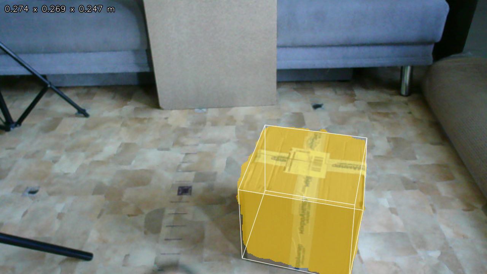

# Example project 4 — Measure a box

**Goal:** put a parcel on the floor, hover the mouse over it, and read its
width, depth and height. No clicking, no markers, no ruler — and then check
every one of the three numbers with a ruler.



*The label reads 0.274 × 0.269 × 0.247 m. The tape says 0.27 × 0.27 × 0.25.
The wireframe is not a drawing over the picture — its eight corners are real
points in space, projected back into the frame.*

> This is example projects 2 and 3 collected in one place. Example project 3 found the floor; that
> floor is what makes "height" mean anything. Example project 2 measured between two
> points; here the points come from the shape itself instead of from your
> mouse.

## What you need

- Any DEPZ stereo camera (Varius / Minima / Clarity) on USB
- The same packages as before:

```bash
pip install -r requirements.txt   # depz-camera-sdk, openvino, numpy, opencv-python
```

- A cardboard box and a tape measure.
- **The camera above the box, looking down.** This one matters: the width and
  depth are read off the lid, so the lid has to be visible. From floor level
  you see two sides and no top, and the far edge of the parcel is anybody's
  guess.
- **Space around the box.** The example project grabs one connected lump of stuff standing
  on the floor. A parcel touching the sofa is, as far as the geometry is
  concerned, part of the sofa.

## Run it

```bash
python box_measure.py
```

Point the camera down until the floor turns up, move the mouse onto the box,
wait a second for the numbers to settle. `s` saves a screenshot, `q` quits.

## How it works, in four steps

**1. Find the floor.** Exactly the RANSAC vote from example project 3, copied over
unchanged: a few hundred random planes, the one that most points agree with
wins, with the same two guards that stop a wall or a table from winning.

**2. Cut the scene into lumps.** Everything between 3 cm and 1 m above that
floor is marked, and `cv2.connectedComponents` splits the marks into separate
blobs. The one under your cursor is the parcel. This is why the box needs
elbow room: touching things are one blob.

**3. Find the lid.** Not the highest point — the **busiest 5 mm slice** of the
blob:

```python
counts, edges = np.histogram(hs, bins=np.arange(MIN_H, hs.max() + 0.005, 0.005))
peak = edges[int(counts.argmax())] + 0.0025
```

A parcel has one big flat top and thin vertical sides, so the top piles into a
single slice while the sides smear across fifty. Taking the highest point
instead sounds simpler and is much worse — on a 34 mm book it reads 45 mm,
because the highest point of anything is the noisiest point of it. The busiest
slice reads 37 mm and holds still to 0.6 mm.

**4. Drop the lid onto the floor and box the shadow in.** Every lid point is
projected onto the floor plane, and `cv2.minAreaRect` finds the tightest
rectangle around that shadow — at any angle, so the parcel does not have to be
square to the camera. Its two sides are the width and the depth.

## The two mistakes worth knowing about

Both were real, both cost an afternoon, and both are one line each.

**Measuring the shadow of the whole box, not just the lid.** Sounds harmless:
the sides are vertical, so they collapse onto the same footprint anyway. But
the *silhouette* of the box — the pixels right on its outline — see the box and
the background at once, and their range lands somewhere in between. Those
strays sit far from the parcel in space, and a bounding rectangle chases them.
It reported a 27 cm box as 71 cm.

**Trusting every remaining point.** Even the lid keeps a few strays around its
rim, and a bounding rectangle can only ever be pushed *outward* by them. But
cleaning too keenly shaves the parcel instead, and it took two knobs, not one,
to separate those jobs — against a taped 27.0 × 27.0 cm:

| cleanup | measured |
|---|---|
| none | 29.8 × 28.3 cm |
| **drop the furthest 1 %, then trim 0.2 % off each edge** | **27.3 × 26.9 cm** |
| drop 2 %, trim 0.5 % | 26.8 × 25.8 cm |
| drop 5 %, trim 0.5 % | 26.8 × 25.1 cm |

The first knob throws away the handful of points that landed metres away; the
second takes a hair off each of the four edges, where the rim pixels live.
Doing it with one knob does not work: trimming 1 % off each edge alone reads
26.4 × 25.8 — the strays are gone, and so are six millimetres of parcel.

## Check it with a ruler

The numbers from the run in the screenshot, 16 frames, box about 1.3 m away:

| | width | depth | height |
|---|---|---|---|
| tape measure | 27.0 cm | 27.0 cm | 25.0 cm |
| this example project | **27.3 cm** | **27.0 cm** | **24.7 cm** |
| off by | +0.3 | 0.0 | −0.3 |
| frame-to-frame wobble | 0.1 | 0.1 | 0.0 |

Every side within three millimetres, and the reading holds still to one.

One caveat about a square parcel like this one: the example project calls the longer side
the width and the shorter one the depth. When the two are genuinely equal, that
choice alone biases the width up and the depth down, because we are picking the
larger of two noisy numbers every frame. On an oblong box the effect vanishes.

Two things to expect if your own numbers come out a little large:

- A parcel is not a perfect cuboid. Bulging cardboard and packing tape are part
  of what the camera sees, and they are honestly a few millimetres wide.
- The tightest rectangle is a *bounding* box. Every leftover stray can only
  push it outward, never inward, so the small bias it has is a bias upward.

## Things to try

- **Turn the box 45°.** The numbers should not change: `minAreaRect` is free to
  tilt, so nothing here assumes the parcel faces the camera.
- **Measure something round.** A bucket gets a square footprint the size of its
  diameter — correct, and a good reminder that the example project reports a *bounding box*,
  not a shape.
- **Stack two boxes.** One lump, one measurement: the height is now the top of
  the stack. That is a feature if you are loading a pallet and a bug if you
  wanted the top box.
- **Move the camera to floor level.** The lid disappears and the depth
  collapses — the failure this example project warns about, worth seeing once.
- **Print the volume.** Three numbers multiplied together is a shipping
  estimate; that is most of what a parcel kiosk does.

## If something goes wrong

- **Nothing happens when I move the camera** — the crosshair stays where you
  left it while the parcel slides out from under it. The example project measures the lump
  *under the cursor* and nothing else, so move the mouse back onto the box.
- **The measurement is enormous (metres)** — the crosshair is on the sofa, or on
  something touching it. Whatever lump you point at is what gets measured.
- **The box merges with the furniture** — they are touching, or nearly. Move
  the parcel into open floor.
- **`floor found — now hover over the box`** — the floor is there, but nothing
  qualifies as a parcel under the cursor. Objects below 3 cm (`MIN_H`) and
  above 1 m (`MAX_H`) are ignored on purpose.
- **The depth comes out much too small** — you are looking at the box from too
  low. The lid has to be in view.
- **`no frames for 5 s`** — the camera stopped delivering: unplugged, or
  another program grabbed it.
- **`HTTP Error 503` or `429` on the very first run** — the model download hit
  a busy server. Every example project pins one shared cache (`~/.cache/depz`); wait a
  minute and start again.

**Next:** [Example project 5 — any table is a touchscreen](../05_touch_table/): the same
plane-finding trick as example project 3, but tight enough to tell a fingertip resting on a
table from one hovering a few millimetres above it.
