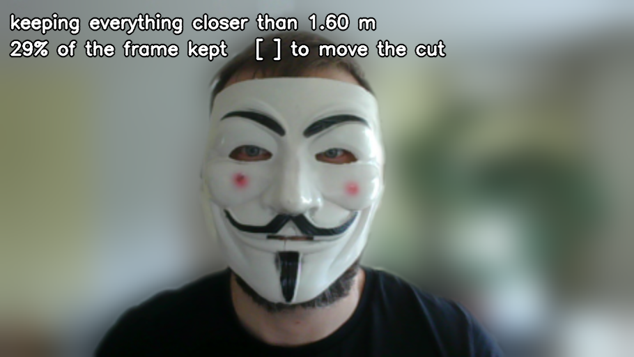

# Example project 7 — A green screen without the green screen

**Goal:** cut the background out by **distance**. No cloth, no lighting rig, no
chroma spill — and it works in front of a bookshelf, a kitchen or a moving
street, where a green screen would need a whole studio.



*Everything closer than 1.60 m is kept, everything beyond it is blurred away —
29 % of the frame survived the cut. The mask is the model's, the anonymity is
the author's.*

## What you need

- Any DEPZ stereo camera on USB
- The same packages as the earlier example projects — no extra models here

```bash
pip install -r requirements.txt
python depth_keying.py
```

- `[` and `]` — move the cut nearer or further (it is printed in the header)
- `b` — background: blur → black → white
- `m` — show the raw mask, `s` — screenshot, `q` — quit

## Why depth beats chroma

A green screen answers the question "is this pixel green?" — which is why it
fails on green jumpers, spills colour onto your hair and needs even lighting.

Depth keying answers "is this pixel near?" instead. Colour becomes irrelevant:
wear whatever you like, stand in front of whatever you like. The cost is that
the edge is only as good as the depth map, and depth maps are fuzzy exactly
where hair meets background.

## Check it with a tape

Set the cut to a round number and walk backwards past it.

| | |
|---|---|
| cut set in the example project | **1.20 m** |
| where you actually vanish, by tape | **1.25 – 1.30 m** |

Close enough for keying, and the few centimetres go the same way every time:
the camera reads slightly short, and the mask is deliberately fattened a pixel
or two so hair does not look cut out with scissors. If you want the cut exactly
where you say it is, measure that offset once and subtract it from `CUT_M`.

Do not expect the same at four metres, though — example project 1 shows the error growing
with the *square* of distance.

## The one line that saves the edges

Left alone, this example project draws a glowing halo around your head. The reason is the
same one that tripped the fence in example project 6: the network fills in **every** pixel,
so along your outline it invents something halfway between you and the wall.
Those pixels are nearer than the wall and further than you, and a naive cut
keeps them.

```python
def solid(depth):
    k = np.ones((3, 3), np.uint8)
    return (cv2.dilate(depth, k) + cv2.dilate(-depth, k)) < EDGE_JUMP
```

It keeps only pixels whose depth does not jump more than 10 cm within their own
neighbourhood. A real surface never does that; an outline always does. Press
`m` and toggle the line off and on if you want to see the halo appear.

After that come three ordinary steps: close the pinholes, drop the specks,
blur the edge by a few pixels so hair does not look cut out with scissors.

## Why the fast model here

Every other example project in this series picks the quiet model and pays with frame rate,
because they measure millimetres. This one does not measure anything — it
composes video, and video wants frames. So it runs the default `lightstereo`
at ~4.6 fps instead of the quiet model's 2.2.

If your cut looks noisy at the edges, switching `MODEL` to
`("lite-any-stereo", "v2-s-480x288")` will steady it and cost you a third of
the frame rate.

## Things to try

- **Put it into a video call.** Pipe the output into a virtual camera
  (`v4l2loopback` on Linux, OBS elsewhere) and the example project becomes a background
  filter that Zoom cannot tell from its own.
- **Cut a slab, not a half-space.** Two thresholds instead of one — keep only
  what lies between 0.8 and 1.4 m — and everything in front of the subject
  disappears too.
- **Key on a table.** Point the camera down and set the cut just above the
  surface: now only the objects on the table survive, ready for a catalogue.
- **Watch it fail.** Hold your hand out towards the lens and cross the cut
  plane with it: the fingers vanish joint by joint. That is the depth map
  being honest about what it measures.

## If something goes wrong

- **A halo around the head** — `EDGE_JUMP` is too large for your scene; try
  0.05.
- **Chunks of you disappear** — you are standing across the cut. Move the
  threshold with `]`, or step forward.
- **The background survives in patches** — those patches are genuinely nearer
  than the cut. Press `m` to see the mask, it makes this obvious immediately.
- **Everything flickers** — the fast model is noisy; switch to the quiet one
  (see above).

---

Back to [the example project index](../../README.md).
