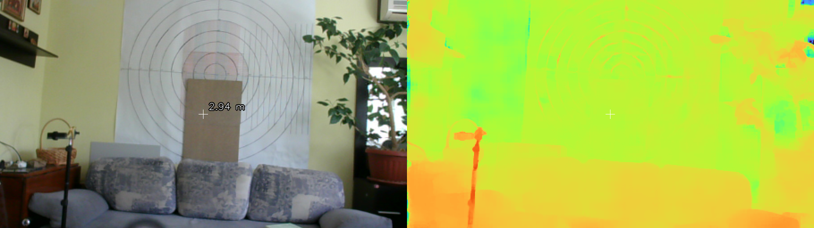

# Lab 1 — Your first depth map

**Goal:** plug in a DEPZ stereo camera and, in under ten minutes, have a live
window where every pixel knows how far away it is — with the distance in
metres shown under your mouse cursor.



*Left: the camera's rectified left eye. Right: the depth map (warm colours =
near, cold = far). The crosshair sits on a sheet of cardboard; the camera says
2.94 m, the tape measure says 2.99 m. Arguing with a tape measure is the whole
point — [see below](#now-argue-with-a-tape-measure).*

> The number under the cursor is the median of the last 9 frames, not a single
> reading. Why that matters is
> [explained below](#why-the-number-needs-nine-frames) — and it is the first
> real lesson about stereo depth.

## What you need

- Any DEPZ stereo camera (Varius / Minima / Clarity) on USB
- Python 3.11+ and three packages:

```bash
pip install -r requirements.txt   # depz-camera-sdk, openvino, numpy, opencv-python
```

No calibration step: the camera is recognised by its serial number and its
factory calibration is fetched automatically on first use.

## Run it

```bash
python lab1.py
```

The first run downloads a ~13 MB neural network; after that the pipeline
starts in about 3 seconds. Move the mouse over either half of the window —
the crosshair shows the same pixel in both, with its distance in metres.
Press `s` to save a screenshot, `q` to quit.

## The whole trick is five lines

```python
from depz_camera_sdk import DepthPipeline

pipe = DepthPipeline(enable_rectified=True)
pipe.start()                 # finds the camera, loads the model
pkt = pipe.get()             # one processed frame
print(pkt.depth[128, 200])   # metres at pixel (row 128, col 200)
```

`pkt.depth` is a plain NumPy array of `float32` metres, aligned
pixel-for-pixel with `pkt.rectified_left`. Both eyes come out in **BGR**, the
order OpenCV already expects — pass them to `cv2` as they are, no `cvtColor`.
Everything else in [lab1.py](lab1.py) (~100 lines) is drawing: a colormap for
the depth image, a mouse callback for the crosshair, and the nine-frame
median described below.

## What is actually happening

The camera has two eyes a known distance apart. The SDK rectifies both
images (straightens them so matching points sit on the same row), a neural
network finds, for every pixel, how far it shifted between the eyes
(the *disparity*), and the factory calibration converts that shift to
metres. You get the result as `pkt.depth`; the raw disparity and a 3D point
cloud are one constructor flag away — we will use them in the next labs.

## Things to try

- **Tape-measure test.** Point the cursor at a wall, read the number, then
  measure it for real. Do it at 1 m and at 4 m — the error grows fast with
  distance, and the next section says exactly how fast.
- **Depth range.** The display maps 0.3–6 m onto the colour scale
  (`MIN_M`/`MAX_M` at the top of the file). Set it to 0.3–2 m and watch your
  desk turn into a relief map.
- **Look at the poster rings.** Thin dark lines on a flat surface show up as
  noisy rings in the depth map: sub-pixel edges are the hardest case for
  stereo matching. Real 3D structure (the sofa, the plant) is far more
  stable than fine printed texture.

## Why the number needs nine frames

Read a single pixel of a single frame and the distance jitters — at three
metres it swings by a good 20 cm. That is not a bug, and it is worth
understanding before Lab 2 asks you to measure things.

The camera does not measure metres. It measures the disparity described above —
a shift in pixels — and metres come out of a division:

```
metres = f·B / disparity        (f·B ≈ 39.1 m·px on this camera)
```

The matcher is steady in its own units. Pointed at a flat target 2.99 m away
for 120 frames, this camera gave:

| | mean | spread over 120 frames | relative |
|---|---|---|---|
| disparity | 13.39 px | 1.22 px | 1.6 % |
| distance | 2.92 m | 0.27 m | 1.6 % |

Sub-pixel wobble, but the division amplifies it — and because `metres` is
inversely proportional to disparity, the same wobble costs more the farther
you look. **One pixel of disparity is worth:**

| distance | 0.5 m | 1 m | 2 m | 3 m | 5 m |
|---|---|---|---|---|---|
| cost of 1 px | 0.6 cm | 2.5 cm | 10 cm | **23 cm** | 64 cm |

The error grows with the *square* of distance. That single table explains most
of what feels flaky about stereo depth, and it is why every serious
measurement in later labs happens as close to the subject as the task allows.

**The fix is averaging over time, not over space.** The tempting move —
median over a 5×5 patch of neighbouring pixels — does nothing at all here
(σ 6.73 cm → 6.75 cm): neighbours flicker *together*, frame to frame, so
there is no independent noise to cancel. Averaging the same pixel across
frames does work:

| reading | σ | spread |
|---|---|---|
| one frame | 4.7 cm | 27 cm |
| median of last 9 frames (what `lab1.py` does) | 2.0 cm | 8 cm |
| median of last 30 frames | 0.8 cm | 3 cm |

Nine frames is a third of a second — no perceptible lag, and the number holds
still enough to argue with a tape measure. That is `depth_at()` in
[lab1.py](lab1.py); raise `SMOOTH_N` if you want it steadier and do not mind
the delay.

Reproduce all of it yourself: point the camera at a flat wall, log
`pkt.disparity[y, x]` and `pkt.depth[y, x]` for a hundred frames, and compare
their relative spreads. (`disparity` is off by default — switch it on with
`pipe.set_stream_enabled("disparity", True)`.)

## Now argue with a tape measure

The screenshot at the top of this page is not a staged demo — it is the check
itself. A sheet of cardboard, a tape measure held from the front lens:
**2.99 m**. The camera, median of nine frames: **2.94 m**. It reads about
**6 cm short — roughly 2 %.**

Before blaming the neural network, rule it out. Same pixel, same scene, three
completely different matchers:

| matcher | distance | spread of a single frame |
|---|---|---|
| `lightstereo` — the default, what this lab runs | 2.914 m | 5.8 cm |
| `lite-any-stereo v2-s-640x384` | 2.892 m | 0.8 cm |
| `sgbm` — classical, no neural network at all | 2.895 m | 1.4 cm |

They agree with each other to within 2 cm, and every one of them reads short
by about the same 10 cm. That pattern is the answer: if the matchers
disagreed, the matcher would be the suspect. Agreement points at the thing all
three share — the calibration that says where the two lenses sit relative to
one another.

In disparity, the gap between 2.892 m and 2.99 m is **0.65 px**. Two thirds of
one pixel. Look again at the table above: at three metres a single pixel of
disparity is worth 23 cm, so two thirds of one costs 8 cm — the entire
discrepancy, from an error you could never see by eye. The same 0.65 px at
half a metre would cost 4 mm.

Two things follow, and they shape every lab after this one:

- **Measure close when the task allows it.** The error grows with the square
  of distance; nothing else you can do buys as much accuracy as stepping
  closer.
- **Trust the tape, not the screenshot.** Your camera is a different unit with
  its own factory calibration. Run this lab, point it at something you can
  reach with a tape measure, and find out what *your* camera's offset is. Every
  lab in this series ends with that same comparison.

Switch matchers yourself with one argument:

```python
DepthPipeline(enable_rectified=True, inference=("sgbm", "360x640"))
```

Note what the table says about `sgbm`: no neural network, four times faster
than the default, and steadier at this particular spot. The trade-off does not
show up here — it shows up as holes in the map where there is no texture to
match. Lab 3 comes back to that.

## If something goes wrong

- `no inference engines available on this host` — install one:
  `pip install openvino` (Intel/AMD CPUs) or `pip install onnxruntime`.
- Camera not found — check `lsusb | grep DEPZ` (Linux); the first resolve
  needs internet access to fetch the calibration for your serial number
  (it is cached afterwards).
- Another program has the camera open — the pipeline needs exclusive access
  to `/dev/video*`; close the DEPZ viewer first.

**Next:** [Lab 2 — a virtual tape measure](../02_virtual_ruler/): click two
points, get centimetres between them.
