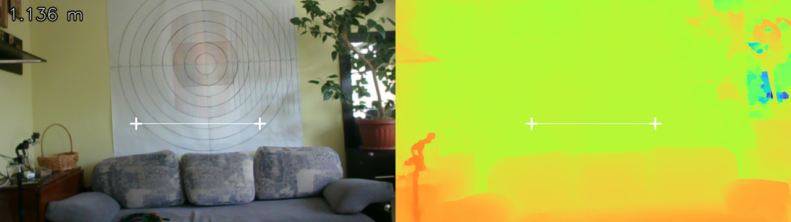

# Lab 2 — A virtual ruler

**Goal:** click two points anywhere in the picture and read the distance
between them in metres — then argue with a tape measure.



*Left: the rectified left eye, with the two picked points and the line between
them. Right: the same two points on the depth map. The camera says the marks
are 1.136 m apart.*

> Lab 1 answered *how far is that*. This lab answers *how big is that* — and
> that is the difference between a curiosity and a tool.

## What you need

- Any DEPZ stereo camera (Varius / Minima / Clarity) on USB
- Python 3.11+ and the same packages as Lab 1:

```bash
pip install -r requirements.txt   # depz-camera-sdk, openvino, numpy, opencv-python
```

- A tape measure and something of a known size — a sheet of A4 paper is ideal,
  because you already know the answer to the millimetre (0.297 × 0.210 m).

## Run it

```bash
python lab2.py
```

The first run downloads a ~21 MB neural network. Click one point, click
another, and the label shows the distance. A third click starts a fresh pair;
`c` clears, `s` saves a screenshot, `q` quits. Either half of the window works
— the two halves are the same pixels.

Give each point a moment after clicking: the reading is the median of the last
3 frames, which at this model's ~2 fps takes about 1.4 seconds to fill.

## The whole trick is four lines

```python
pipe = DepthPipeline(enable_rectified=True, enable_cloud=True,
                     inference=("lite-any-stereo", "v2-s-640x384"))
pipe.start()
pkt = pipe.get()
print(pkt.point_cloud[180, 240])   # -> [-0.452 -0.072  2.894] metres
```

`pkt.point_cloud` is an H×W×3 array of metres: for every pixel it holds **X**
(to the right), **Y** (down) and **Z** (away from the camera). So the pixel at
row 180, column 240 above sits 0.45 m to the left of the camera axis, 0.07 m
up, and 2.89 m out.

With two of those, the distance is school geometry in three dimensions:

```python
import numpy as np
a, b = pkt.point_cloud[180, 240], pkt.point_cloud[180, 400]
print(np.linalg.norm(a - b))       # -> 0.897 metres between those two pixels
```

No trigonometry, no focal lengths, no calibration maths of your own — the SDK
already did all of it.

## What is actually happening

The picture and the point cloud are **the same table**, just with different
things in the cells. In the left eye a cell holds a colour; in `depth` it holds
one number (metres to that point); in `point_cloud` it holds three. The table
is the same size in all three, so "row 180, column 240" means the same speck of
the world everywhere.

That is why clicking works on the flat image: the mouse gives a cell address,
and the cloud hands back that cell's three coordinates. You never have to spin
a 3D view around — and hitting the exact point you want is far easier on a
photograph than inside a floating cloud of dots.

One consequence worth knowing: you can only measure **surfaces the camera can
see**. Clicking the front and the back of a box will not give you its depth,
because the back is not in the picture. Measuring a whole box comes in Lab 4,
and it works differently.

## Why this lab changes the model

Lab 1 used the SDK's default network. A ruler needs a steadier one. Same room,
same static scene, targets about 2.9 m out, 150 frames each:

| | `lightstereo` (Lab 1 default) | `lite-any-stereo` (this lab) |
|---|---|---|
| wobble of one point's range | 5.31 cm | **0.96 cm** |
| a measurement, single frame | 4.00 cm (12.1 %) | **0.26 cm (1.2 %)** |
| a measurement, median of 3 | 2.33 cm (7.0 %) | **0.17 cm (0.8 %)** |
| depth map size | 455×256 | 640×360 |
| speed | 5.4 fps | 2.1 fps |

The point that settles it: **one frame of the steady model beats fifteen frames
of the default**. Averaging cannot rescue the fast network — it is not noise
that longer waiting removes, it is the limit of that model. So the price of
accuracy here is the frame rate, not your patience.

If you want the live view to feel smooth instead, delete the `inference=` line
and raise `SMOOTH_N` to 15: you get 5.4 fps and a 2.7-second wait per point,
for about 0.9 cm of error — fine for a rough check, weak against a tape measure.

**Bigger things measure better — in percent.** The error barely depends on the
size of what you measure, so the *relative* error shrinks as the object grows
(`lite-any-stereo`, median of 3 frames):

| distance measured | 22.6 cm | 56.2 cm | 111.6 cm |
|---|---|---|---|
| wobble | 0.17 cm | 0.22 cm | 0.27 cm |
| relative | 0.8 % | 0.4 % | 0.2 % |

So a sheet of A4 is close to the hardest case, and a doorway is easy.

**Why the averaging is over time again.** Lab 1 showed that neighbouring pixels
flicker *together*, so averaging over a patch buys nothing. There is a twist
here: that togetherness only reaches about 15 pixels. Two points that close
still wobble in step (correlation +0.8) and their errors partly cancel when you
subtract them — but at 40 pixels apart the correlation is gone and each point
wobbles on its own. Which is why the fix is the same as in Lab 1: median each
point over consecutive frames (`SMOOTH_N` in [lab2.py](lab2.py)).

## Check it with a tape measure

This is the point of the whole lab, so do it properly:

1. Tape a sheet of A4 to a wall, about 1.5 m from the camera.
2. Click its two top corners. Wait a second and a half for the reading to
   settle.
3. The answer should land near 0.297 m.
4. Now do the same at 3 m and at 4 m, and watch the error grow — Lab 1
   explains why it grows with the *square* of the distance.

Measure **across** your view rather than into it: two points side by side are
far more reliable than one near and one far, because a difference in Z leans
directly on the range error, which is the big one.

## Things to try

- **Measure yourself.** Click the top of your head and the floor. Stand
  1.5 m away and keep still for a second.
- **Where it breaks.** Click a point on a thin object — a chair leg, a plant
  stem — and one on the wall behind it. The reading jumps around, because those
  pixels sit on a depth edge where the matcher is least sure.
- **Watch the two halves agree.** Click the same feature on the left image and
  then on the depth map. They are the same pixels, so the answer must not
  change — a good check that you are reading the cloud correctly.
- **Raise `SMOOTH_N`** to 9 and the error drops to 0.10 cm, at the cost of a
  four-second wait per point. Past that the gain is not worth the standing
  around.

## If something goes wrong

- The label stays at `click two points` — one of your clicks landed on a pixel
  with no valid depth (a dark or mirrored surface). Click somewhere textured.
- `no inference engines available on this host` — install one:
  `pip install openvino` (Intel/AMD CPUs) or `pip install onnxruntime`.
- Another program has the camera open — the pipeline needs exclusive access to
  `/dev/video*`; close the DEPZ viewer first.
- The window feels sluggish — it is: ~2 fps is this model's price, and the
  section above explains why it is worth paying here.

**Next:** [Lab 3 — find the floor](../03_floor_detection/): fit a plane to the
point cloud, paint the floor green and everything standing on it red.
