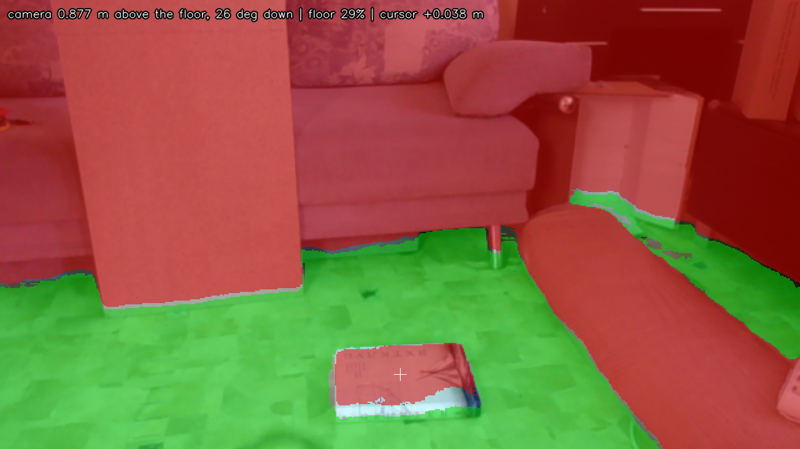

# Lab 3 — Find the floor

**Goal:** let the camera work out where the floor is, paint it green, paint
everything standing on it red — and tell you how high the camera itself is
above that floor. Which you can check with a tape measure in ten seconds.



*The floor is found, not assumed: nobody told the camera where the ground is or
which way is down. The label says the camera is 0.877 m above it, tilted 26°
down, and that the floor fills 29 % of the view. The crosshair sits on a book
lying on the floor: 0.038 m up. The book is 34 mm thick by ruler, and the tape
put the camera at 0.875–0.877 m.*

> Labs 1 and 2 read individual points. This one asks a question about the
> **whole scene at once**, and gets back something no single point can give
> you: a reference surface that every other height is measured against.

## What you need

- Any DEPZ stereo camera (Varius / Minima / Clarity) on USB
- The same packages as before:

```bash
pip install -r requirements.txt   # depz-camera-sdk, openvino, numpy, opencv-python
```

- A tape measure, and a camera pointed so that a decent patch of floor is in
  view. Anywhere from waist height looking down works well.

## Run it

```bash
python lab3.py
```

Green is the floor, red is anything at least 3 cm above it. The label shows the
camera's height above the floor, how far down it is tilted, and how much of the
view the floor takes. Move the mouse to read the height of any point above the
floor. `s` saves a screenshot, `q` quits.

## The whole trick

```python
tri = pts[np.random.randint(0, len(pts), (600, 3))]      # 600 random triples
n = np.cross(tri[:, 1] - tri[:, 0], tri[:, 2] - tri[:, 0])   # a plane each
n /= np.linalg.norm(n, axis=1)[:, None]
d = -(n * tri[:, 0]).sum(axis=1)
votes = (np.abs(pts @ n.T + d) < 0.02).sum(axis=0)       # who touched most?
```

That is the entire idea, and it has a name: **RANSAC**. Picture throwing a
sheet of cardboard at the point cloud six hundred times and keeping the throw
that touched the most points. Three points define a plane, so each "throw" is
just three random points from the cloud. The floor wins because it is the
biggest flat thing in the room — here it collects 29 % of all points, and
nothing else comes close.

Two guards keep it honest, and without them it picks the wrong plane:

- **`MAX_TILT`** — reject planes that stand up like walls. A wall is flat and
  huge too, and it would happily win the vote.
- **`MIN_DROP`** — the plane has to sit at least 30 cm *below* the camera.
  Otherwise a table top, or a plane cutting straight through the camera, can
  take the prize.

Once the winner is known, we refit it properly on every point it touched (that
is the `np.linalg.svd` line in [lab3.py](lab3.py)) — the random three points
were only ever a way to find the floor, not to describe it.

Six hundred throws is already enough. Raising it to six thousand, and the
sample from 4 000 points to 40 000, leaves the answer exactly where it was
(4.8 mm of frame-to-frame wobble either way) and costs 21 ms → 1394 ms per
frame. The randomness of the search stopped being the limiting factor a long
time before it stopped being cheap.

## What is actually happening

The result is a plane: a direction that points straight down (the **normal**)
and a distance. Two useful things fall out of it for free:

- **How high the camera is.** The distance from the camera to that plane.
  Nobody measured it — it came out of the geometry of the room.
- **How high anything else is.** For every pixel, its distance to that plane.
  That is the whole colouring: near zero → floor → green; well above → red.

Notice what we never needed: no calibration ritual, no telling the camera which
way is up, no marker on the ground. Tilt the camera and the reported height
stays the same while the tilt angle changes — the floor is being found afresh
in every frame.

## Which model, and why it is not the fast one

This lab runs `lite-any-stereo v2-s-640x384`, the same network as Lab 2, and
pays for it in frame rate. Measured on one still scene, camera about 0.88 m up,
20 frames per model, with a tape measure reading **0.875–0.877 m**:

| model | height it reports | wobble of that height | pixels with a range | fps |
|---|---|---|---|---|
| `lightstereo` (SDK default) | 0.888 m | 24.5 mm | 100 % | 4.9 |
| `sgbm` (no network at all) | 0.866 m | 25.9 mm | **78 %** | 13.0 |
| **`lite-any-stereo`** | **0.870 m** | **7.8 mm** | 100 % | 2.3 |

The steady network wins twice over: three times less wobble, and the closest
answer to the tape. `sgbm` is the surprise — on a flat target it is one of the
most accurate options in the box, but a floor is not a flat target. It leaves
22 % of the frame without a range at all, and the holes fall exactly where a
plain floor gives the matcher nothing to lock onto.

One honest caveat, and it is the reason the label prints three decimals it
cannot really justify: the three models disagree about the **absolute** height
by about 2 cm, all of them straddling the tape. Steadiness is not the same as
correctness. Treat the reported height as good to a couple of centimetres.

## Does fitting a plane beat reading one point?

Not the way you would expect, and it is worth being straight about it.

Lab 1 measured a single point's range wobbling by about 5 cm at three metres,
and showed that averaging over neighbouring pixels does not help, because
neighbours flicker together. Lab 2 pinned down how far that togetherness
reaches: about 15 pixels. A plane fitted on a hundred thousand points spread
across the whole frame is well beyond that radius, so the obvious expectation
is that all that noise cancels.

Measured on the scene in the screenshot, over 25 frames:

| | one floor point at 1.39 m | the whole floor plane |
|---|---|---|
| wobble between frames | 1.1 mm | 4.9 mm |

The plane is **less** steady than a single point that went into it. And no,
that is not the random search: throwing ten times as much sampling at it
changes nothing (see above). What is left is that the depth map does not
flicker point by point — it breathes as a whole, drifting a little between
frames, and a plane fitted to a breathing surface breathes with it. Averaging
over space cannot remove an error that space shares.

So the plane is not here to beat a single reading. It is here to give you
something a single reading cannot: **a reference surface**. "1.39 m from the
camera" tells you nothing about whether you can drive over it. "38 mm above the
floor" does — and that number only exists once the floor does.

## Check it with a tape measure

1. Read the height in the label.
2. Measure from the floor up to the camera lens.
3. They should agree within a couple of centimetres.

On the run in the screenshot: label **0.877 m**, tape **0.875–0.877 m**.

Then check the second number, which is the more useful one. Put a book on the
floor, park the crosshair in the middle of its cover, and compare with a ruler:
here **38 mm** against a book that measures **34 mm**. Aim for the middle of a
face, not an edge — a pixel on the edge sees both the book and the floor behind
it and reports something in between. And expect the cursor number to dance by
about a centimetre: unlike the camera height, it is a single pixel of a single
frame with no averaging at all.

A kitchen worktop should land near 0.9 m, a sofa seat near 0.45 m, a standard
step near 0.17 m.

## Things to try

- **Tilt the camera.** The tilt angle changes, the height does not. Nothing was
  hard-coded about which way is down.
- **Put a box on the floor.** It turns red immediately, and the crosshair reads
  its height. That is Lab 4 knocking.
- **Make an obstacle map.** Paint red only what sits between 5 cm and 50 cm
  above the floor: that is exactly what a robot vacuum needs to know, and the
  walls stop drowning the picture.
- **Watch `TOL` decide what counts as flat.** At the shipped 2 cm, a 34 mm book
  is an obstacle. Put it back to 4 cm and the book turns green — it is not that
  the camera stopped seeing it, it is that you widened the definition of
  "floor" past the height of a book. A thin rug sits in the same grey zone.
- **Point the camera at a wall.** The label says no floor was found — the
  guards did their job instead of confidently painting a wall green.

## If something goes wrong

- **`no floor in view`** — the floor is not visible, or it is less than 30 cm
  below the camera (`MIN_DROP`). Point the camera down a bit.
- **The wall turns green** — your camera is tilted more than `MAX_TILT` (60°),
  so a wall now looks more floor-like than the floor. Raise the limit or level
  the camera.
- **The floor flickers between two heights** — you are probably seeing a floor
  and a large rug or a low platform competing for the vote. Narrow `TOL`.
- **Patches of floor refuse to turn green** — `TOL` is 2 cm, which is tight.
  Real floors are not perfectly flat, and neither is the depth map at four
  metres. Widen it to 3 cm.
- **`no frames for 5 s`** — the camera stopped delivering: unplugged, or
  another program grabbed it. The lab says so and exits instead of hanging.
- Another program has the camera open — close the DEPZ viewer first.
- **`HTTP Error 503` or `429` on the very first run** — that is the model
  download hitting a busy server, not a bug in the lab. Every lab pins one
  shared cache (`~/.cache/depz`), so once a model is there it is never fetched
  again; wait a minute and start again.

**Next:** [Lab 4 — measure a box](../04_box_measure/): with a ruler and a floor,
the width, depth and height of a parcel in centimetres.
