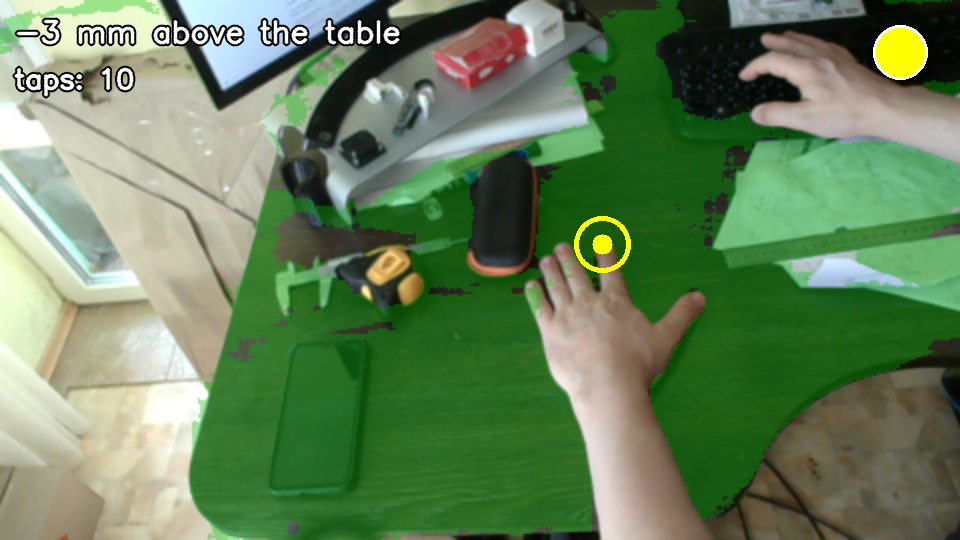

# Lab 5 — Turn any table into a touchscreen

**Goal:** point the camera at an ordinary table, and have it tell you — to the
millimetre — how far your fingertip is above the surface. Close enough, and
that is a tap.



*The table is tinted green — that is the plane the camera fitted to it. The
yellow ring is the fingertip, the lamp in the corner lights up on contact, and
ten taps have been logged. The header reads −3 mm: the lab has been calibrated,
so a touching finger sits at zero give or take a couple of millimetres.*

## What you need

- Any DEPZ stereo camera on USB, looking down at a table from ~30 cm above it
- Python 3.11+ and the usual packages, plus MediaPipe for hand tracking:

```bash
pip install -r requirements.txt
pip install --no-deps mediapipe
pip install absl-py flatbuffers sounddevice certifi matplotlib
```

MediaPipe needs the `--no-deps` line: left to itself it pulls in a second
OpenCV package (`opencv-contrib-python`, a major version ahead), which
silently replaces the one the earlier labs are tested against. The three
packages on the last line are what it actually needs to import.

The hand model (7.8 MB) downloads itself on the first run, the way the SDK
fetches its own models.

## Run it

```bash
python lab5.py
```

Show your hand. The header prints the height of your index fingertip above the
table; touch the surface anywhere and the lamp lights up.

- `c` — calibrate: rest your finger on the table and press it
- `r` — reset the counter, `s` — screenshot, `q` — quit

## Why a resting finger reads 10 mm, not 0

Start the lab, touch the table, and the header will say something like
`+12 mm` while insisting the tap counted. Nothing is broken. The camera cannot
see the point where skin meets wood; it sees the **top of your fingertip**.
That is about a centimetre above the table, and it stays about a centimetre no
matter where on the table you press.

A constant offset is the easy kind of error: measure it once and subtract it.
That is what `c` does. Press it with your finger resting on the table and the
reading drops to zero.

## How it works

1. **Fit a plane to the table.** The same RANSAC trick Lab 3 used on the floor:
   guess a plane from three random points, count how many points land on it,
   keep the winner. Only points nearer than 1.2 m take part — beyond that is
   the room, not the table.
2. **Leave your hand out of the fit.** Your palm is flat, close and large, so
   the plane search happily includes it and lands a couple of centimetres too
   high — slicing your hand in half. The code cuts the hand's bounding box out
   of the cloud before fitting.
3. **Find the fingertip.** MediaPipe returns 21 points per hand; number 8 is
   the tip of the index finger. It runs on the rectified left image, which is
   aligned pixel-for-pixel with the depth map, so the point lands where the
   depth is.
4. **Subtract.** Height above the table is the distance from that 3-D point to
   the plane. Under `TOUCH_MM` (18 mm by default) counts as a tap.

The table is only re-fitted every tenth frame: it is not going anywhere, and
the search costs time better spent on frames.

## Check it with a ruler

Put something of a known thickness on the table and rest your finger on top of
it. The reading should grow by exactly that thickness.

| | |
|---|---|
| finger resting on the bare table | 9.9 mm |
| finger resting on a glasses case | 43.5 mm |
| **difference measured by the camera** | **33.6 mm** |
| **the case, measured with a ruler** | **35 mm** |
| error | **−1.4 mm** |

Frame-to-frame noise on a still finger is **±2 mm**, so a tap threshold of
18 mm sits nine standard deviations clear of the noise. That is why the lamp
never flickers.

## Why this model, and why no smoothing

Two settings were chosen by measurement, not by taste — a still finger, forty
frames each:

| depth model | speed | noise (σ) | spread |
|---|---|---|---|
| `lightstereo` (the default) | 4.6 fps | 4.7 mm | 18 mm |
| `lite-any-stereo` 640×384 | 2.2 fps | 1.1 mm | 5.3 mm |
| **`lite-any-stereo` 480×288** | **3.5 fps** | **1.0 mm** | 5.1 mm |
| `lite-any-stereo` 320×192 | 6.0 fps | 3.0 mm | 14.1 mm |

The default model is twice as fast, but its *spread* is 18 mm — exactly the
tap threshold, so the lamp would fire on noise alone. The smallest variant is
faster still and almost as bad. The 480×288 map is the sweet spot: same
millimetre of noise as the big map, one and a half times the frame rate.

And because the noise is already a millimetre, this lab does **no averaging
over time at all** — unusual for this series, where every other lab medians
over frames. A three-frame median here added 1.2 s of lag and made taps feel
like they registered "every other time". Averaging buys nothing when the
signal is already still; it only costs response.

## Things to try

- **Move the threshold.** `TOUCH_MM` at the top of the file. At 5 mm you have
  to press properly; at 40 mm the table reacts to a hovering hand.
- **Draw buttons on paper.** Put a sheet with drawn keys on the table: the
  plane fit does not care, and now the paper is a keyboard.
- **Tap through a book.** The lab measures height above the plane, so resting
  your finger on a book gives you the book's thickness — a ruler in reverse.
- **Watch it fail on a mirror.** Glass and gloss give stereo nothing to match;
  the plane search will wander. Matte surfaces work best.

## If something goes wrong

- **"point the camera at a table"** — no plane found. The camera has to see a
  decent patch of the surface, and it must be within 1.2 m (`MAX_RANGE`).
- **The green tint sits above the table and cuts your hand in half** — the
  hand got into the plane fit. That is what the bounding-box cut prevents; if
  your whole frame is hand, back the camera off a little.
- **Taps fire on their own** — the surface is too far away or too glossy, so
  noise grew past the threshold. Move closer, or raise `TOUCH_MM`.
- **No hand found** — MediaPipe wants the hand reasonably large in frame. Half
  a metre from the lens is comfortable.

---

Next: [Lab 6 — a virtual fence](../06_virtual_fence/) puts a guarded zone on
the floor and raises the alarm when something steps into it.
