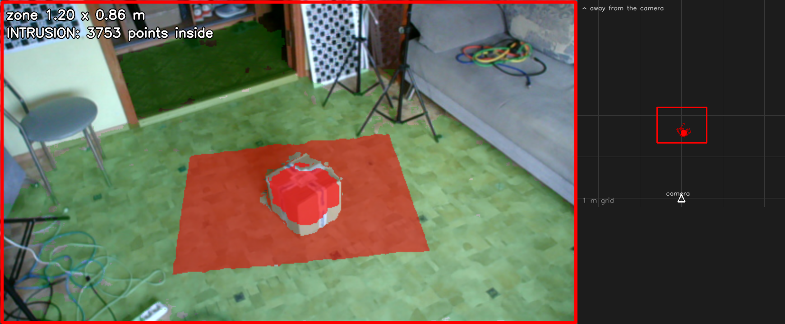

# Lab 6 — A virtual fence on your floor

**Goal:** draw a rectangle on the floor with two mouse clicks, and have the
camera raise the alarm when anything steps into it. Plus a bird's eye plan of
the room, so you can see the zone from above.



*The floor is tinted green. The zone — 1.20 × 0.86 m, set by two clicks — has a
box standing in it, so everything turns red: the zone, the intruder, the frame.
On the right is the plan: the camera at the bottom, a one-metre grid, the zone,
and the intruder's footprint inside it.*

## What you need

- Any DEPZ stereo camera on USB, mounted high enough to see the floor
- The same packages as the earlier labs — no hand tracking here

```bash
pip install -r requirements.txt
```

## Run it

```bash
python lab6.py
```

Wait for the floor to turn green, then click two points on the floor: those are
opposite corners of your zone. Walk into it, or put a box there.

- `c` — clear the zone and draw a new one, `s` — screenshot, `q` — quit

## It does not look for people

The obvious way to build this is to detect a person and check where they stand.
This lab does not do that, and the reason is worth a paragraph.

A fence only needs to know **whether anything is in the air above the zone**.
So the code takes every 3-D point, drops it straight down onto the floor plane,
and counts how many land inside your rectangle above ankle height. A person, a
box, a robot vacuum, a forklift — all the same to it. No model to download, no
question of whether the pose network can see legs that are half out of frame.

Real warehouse systems work this way for exactly this reason.

## The four things that make it work

Each of these came out of an evening of watching it fail:

1. **Do not split the scene into objects.** The first version grouped
   connected lumps of "stuff above the floor" and checked each one. But that
   mask includes the walls and the sofa, so a person standing near them merges
   into one giant blob whose centre is over by the wall — and the alarm stays
   silent. Counting points in the zone has no such problem.
2. **The plan needs real directions.** Lab 4's `basis()` returns any two
   perpendicular directions in the floor, which is fine for boxing in a parcel
   at an arbitrary angle. On a map it is not: the zone came out drawn to the
   left of the camera while it lay straight ahead. Here "forward" has to be the
   camera's own viewing axis, flattened onto the floor.
3. **Throw away the invented pixels.** The network fills in *every* pixel, so
   along your silhouette it returns something halfway between you and the wall
   behind you. Those points float in mid-air behind you — and when you stand
   just *outside* the zone, they drift into it and trip the alarm. The symptom
   was unmistakable: a thin red rim along the edge of the body, with the body
   itself not marked at all. The fix is one line of morphology: drop any pixel
   whose depth jumps more than 10 cm within its own 3×3 neighbourhood. Real
   surfaces do not do that; edges always do.
4. **Ankle height, not knee height.** The intruder threshold started at 30 cm
   and a 25 cm box was invisible to it. At 8 cm the box counts and a doormat
   does not.

## Check it with a tape

The zone is measured on the floor, so the tape goes on the floor too. Lay a
ruler down, click its two ends, and read the last number the lab prints:

```
zone set: 0.78 x 0.05 m | corners 0.783 m apart (check this one with a tape)
```

| | |
|---|---|
| ruler on the floor | **80.0 cm** |
| camera, distance between the clicked points | **78.3 cm** |
| error | **−1.7 cm, or −2.1 %** |

That is the same 2 % this camera reads short at this range everywhere else in
the series — Lab 1 measures the same thing against a tape at three metres.

Note *which* number to check: the two sides of the zone are measured along the
room's axes, so a ruler lying at an angle will split into two smaller numbers
(`0.78 × 0.05` above). The distance between the corners is the honest one.

## Why the zone looks like it floats

Point the camera down from head height and the painted zone will appear to sit
somewhere around a standing person's waist, not under their feet. That is
perspective, not a bug: the floor immediately below a high camera is out of
frame entirely, so a zone two metres away projects into the middle of the
picture.

The projection itself was checked numerically — pixel to metres and back lands
within **0.00 px** — so if the zone looks odd, move the camera, not the code.

## Things to try

- **Guard a doorway.** Two clicks across the threshold and you have a tripwire
  that counts as it fires.
- **Raise the threshold.** `INTRUDER_H` at 0.50 m ignores pets and robot
  vacuums but still catches people.
- **Watch the plan instead of the picture.** With the camera in a corner, the
  bird's eye view is a far better map of the room than the camera view is.
- **Break it on purpose.** Comment out the `solid()` filter and stand just
  outside the zone: the false alarm comes back, and you can see the rim of
  invented pixels that causes it.

## If something goes wrong

- **"no floor in view"** — the floor has to be at least 30 cm below the camera
  (`MIN_DROP`) and tilted less than 60° (`MAX_TILT`). Point the camera down.
- **The alarm fires with nothing in the zone** — some furniture stands inside
  it. The fence counts anything above ankle height, chairs included.
- **The alarm never fires** — check `MIN_PIXELS`: a small object far away may
  simply not have 250 points on it.
- **The zone lands somewhere else than you clicked** — you clicked a point with
  no depth (a window, a mirror, a dark corner). Click on plain floor.

---

Next: [Lab 7 — a green screen without the green screen](../07_depth_keying/)
cuts the background out by distance.
